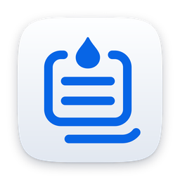

<div align="center">



# DewClip

**A local-first clipboard history manager for macOS.**

[](https://github.com/REXKEV214/dew-clip/releases/latest)
[](https://github.com/REXKEV214/dew-clip/releases/latest)
[](LICENSE)

English · [简体中文](README.zh-CN.md)

</div>

## Features

### History & Search
- **Automatic multi-type capture**: Records plain text, rich text, code, links, images, and copied files or videos, showing source app icons and timestamps. Identical copies merge automatically (rich text with different HTML formatting is kept separately).
- **Live search & type filters**: Filters as you type across text content, file and video names, source app names, and OCR text extracted from images, with quick tabs for Text, Images, Videos, Files, Links, and Code.
- **Instant side-panel preview**: Hover or select a card and hold <kbd>Space</kbd> to preview full text, original images, or videos without leaving the panel.

### Fast Paste, Batch & Sequential Paste
- **Keyboard-first pasting**: Press <kbd>↩</kbd> to paste, <kbd>⇧</kbd> <kbd>↩</kbd> to paste as plain text, <kbd>⌘</kbd> <kbd>1</kbd>–<kbd>⌘</kbd> <kbd>9</kbd> to paste any of the top nine items (hold <kbd>⌘</kbd> to show number badges), or <kbd>⌘</kbd> <kbd>C</kbd> to copy without pasting.
- **Format choices & editing**: Right-click text items to paste in original format, plain text, or Markdown (converting HTML to Markdown and wrapping code in fenced blocks). Edit text in place to save, save and paste, or save as a new entry.
- **Batch actions**: Select multiple items to delete together, or reorder them and join text with newlines, spaces, or punctuation for a single paste that restores your previous clipboard afterward.
- **Sequential paste**: Start a collecting session from the header or menu bar so each copy queues up automatically, or launch a one-off round from Batch mode. Reorder or trim the queue in the side panel, then paste step by step with <kbd>⌥</kbd> <kbd>V</kbd> (customizable; active only while items are queued).

### Favorites
- **Saved phrases & media**: Save phrases manually or add text, images, videos, and files from history. Media favorites are copied into DewClip's data folder so they stay available even if the original file moves or history is cleared.
- **Organize & search**: Add optional titles and tags, drag to reorder, filter by tag, and search live across titles, tags, phrase text, and media file names.

### On-Device OCR & Translation
- **Local image OCR**: Uses Apple Vision on your Mac to recognize Simplified Chinese, Traditional Chinese, and English text in copied images for search and one-click "Paste as Text".
- **Chinese ↔ English translation**: Translates text and rich text entries. Uses on-device Apple Translation by default on macOS 26+, or switch to DeepL or any OpenAI-compatible API (including local loopback servers such as Ollama).

### Window, Appearance & Menu Bar
- **Native macOS appearance**: Choose **System**, **Light**, or **Dark** appearance, 6 theme colors, and adjustable glass transparency across both the main panel and the copy notification capsule.
- **Flexible window behavior**: Summons over native full-screen spaces, opens at cursor / last position / fixed position, and supports both **Always on Top** and **Normal Window** pin modes.
- **Copy notification & menu bar**: Optional top-of-screen copy capsule (Glass Pill, Black Notch, or Black Pill with adjustable duration), hideable menu bar or Dock icons, live English / Simplified Chinese switching (including the menu bar menu), and quick **Pause Recording** timers right from the menu bar.

## Installation

Download `DewClip_1.1.0.dmg` (Apple silicon) from [GitHub Releases](https://github.com/REXKEV214/dew-clip/releases/latest).

1. Open the `.dmg` and drag `DewClip.app` into **Applications**.
2. Launch DewClip from **Applications**.
3. If macOS blocks the first launch with an unverified developer warning, dismiss the dialog.
4. Open **System Settings → Privacy & Security**, scroll to the **Security** section, and click **Open Anyway** next to DewClip.
5. Confirm **Open Anyway** and authenticate with Touch ID or your password.

> [!NOTE]
> DewClip releases are ad-hoc signed and not notarized with Apple, so macOS requires this one-time approval on first launch.

## Keyboard Shortcuts

| Action | Shortcut | Notes |
| --- | --- | --- |
| Show / hide panel | <kbd>⌥</kbd> <kbd>Z</kbd> | Default for new installs; customizable in Settings |
| Move selection | <kbd>↑</kbd> / <kbd>↓</kbd> | Navigate items in the history list |
| Paste selected item | <kbd>↩</kbd> or click | Copies only if Accessibility permission is not granted |
| Paste as plain text | <kbd>⇧</kbd> <kbd>↩</kbd> | Pastes the selected item without formatting |
| Quick paste top 9 items | <kbd>⌘</kbd> <kbd>1</kbd>–<kbd>⌘</kbd> <kbd>9</kbd> | Hold <kbd>⌘</kbd> briefly to show number badges |
| Copy without pasting | <kbd>⌘</kbd> <kbd>C</kbd> | Places the selected item on the clipboard |
| Quick preview | Hold <kbd>Space</kbd> | Previews the hovered or selected card; release to close |
| Focus search | <kbd>⌘</kbd> <kbd>F</kbd> | Searches history, or Favorites when focus is in Favorites |
| Switch type filter | <kbd>Tab</kbd> / <kbd>⇧</kbd> <kbd>Tab</kbd> | Cycle through All and content type tabs |
| Batch select all | <kbd>⌘</kbd> <kbd>A</kbd> | Enters Batch mode and selects all loaded items |
| Paste next in sequence | <kbd>⌥</kbd> <kbd>V</kbd> | Default; active only while items are in the queue |
| Delete item | <kbd>⌘</kbd> <kbd>⌫</kbd> or <kbd>Delete</kbd> | Deletes selected item, or confirms batch deletion |
| Close window | <kbd>⌘</kbd> <kbd>W</kbd> | Hides and unpins the window; prompts if edits are unsaved |
| Dismiss / unpin | <kbd>Esc</kbd> | Closes open editors, panels, or search, then hides and unpins |
| Item actions | Right-click a card | Open, Paste as, Add to Favorites, Batch Actions, Add to Sequential Queue (while Sequential Paste is active), Stop Recording This App, Share |

## System Requirements & Permissions

| Requirement | Details |
| --- | --- |
| **Minimum macOS** | macOS 14 or later (Apple silicon). Only macOS 26 is tested. |
| **macOS 26+** | Required for native Liquid Glass styling and on-device Apple Translation. |

### Permissions & System Prompts
- **Accessibility (recommended)**: Used only to simulate <kbd>⌘</kbd> <kbd>V</kbd> for automatic, batch, and sequential pasting. Without it, DewClip still records and searches history, and clicking an item copies it so you can paste manually with <kbd>⌘</kbd> <kbd>V</kbd>.
- **Launch at Login**: On a fresh install launched from Applications, DewClip enables Launch at Login once (macOS may show a "Background Items Added" notification). You can toggle it off anytime in **Settings → General**.
- **Folder access**: Asked by macOS on demand only when you copy or open files inside protected folders such as Desktop or Downloads.
- **Keychain access**: Prompted only if you save a third-party translation API key.

## Data, Storage & Privacy

- **Local-first storage**: History and favorites are stored locally in `~/Library/Application Support/io.github.rexkev214.dewclip` (thumbnails cache in `~/Library/Caches/io.github.rexkev214.dewclip`). In **Settings → Data**, you can move the data folder to an empty directory, turn off **Keep History** (keeping new items in memory for the current session only), configure **Keep History For** (7 days to 1 year, or Forever) and an optional **Storage Limit** (500 MB to 5 GB), inspect storage usage, and clear the thumbnail cache. Pinned items, tagged items, and favorites are preserved during automatic cleanup.
- **Privacy protections**: Password-manager concealed and transient clipboard items (`org.nspasteboard.ConcealedType`, `TransientType`, `AutoGeneratedType`, and similar markers) are never recorded. You can also add apps to **Ignored Apps** (or right-click any card and choose **Stop Recording This App**) and pause recording temporarily from the menu bar.
- **Local key protection**: Third-party translation API keys are stored encrypted in the local database using a master key kept in your macOS Keychain.

### Network Use

DewClip has no accounts, no analytics, and no cloud sync. It only connects to the network in these three cases — nothing else:

| Feature | What is sent | Control & behavior |
| --- | --- | --- |
| **Third-party translation** (DeepL / OpenAI-compatible) | The item's text as soon as the Translate panel opens (and when re-translating), plus a fixed English test sentence when clicking **Test Connection** | Only when you configure and use a third-party provider. Apple Translation runs on-device (macOS manages language packs), and loopback servers (such as Ollama) stay local. |
| **Remote images in copied rich text** | Requests to `https://` image URLs referenced in copied web content | Automatic while enabled in **Settings → Privacy** (on by default) so copied web content keeps its images. Non-HTTPS links and local/private network addresses are blocked; per-image size limit is configurable (2–16 MB) and downloading can be turned off. |
| **Update check** | At most one daily request to the GitHub Releases API (`api.github.com/repos/REXKEV214/dew-clip/releases/latest`) with `User-Agent: DewClip` and no device identifiers or cookies | On by default; can be disabled in **Settings → General** or run manually from the bottom of Settings. Only links to the release page and never installs updates by itself. |

## Updating, Uninstalling & FAQ

<details>
<summary><strong>How do I update DewClip?</strong></summary>

DewClip checks GitHub Releases once a day by default (or when you click **Check for Updates** in Settings) and links you to the release page when a newer version is available. It never downloads or installs updates automatically.

To update, download the new `.dmg`, quit DewClip, and drag the new `DewClip.app` into **Applications** to replace the old one. Your history, favorites, and settings are preserved.

</details>

<details>
<summary><strong>Auto-paste stopped working after updating</strong></summary>

Because DewClip is ad-hoc signed, replacing `DewClip.app` changes its code signature and causes macOS to drop the previously granted Accessibility permission (even if the toggle still looks enabled).

To fix this:
1. Click **Authorize** in DewClip's prompt or **Grant Access** in **Settings → General**, then re-enable DewClip in System Settings.
2. If it still only copies without pasting, open **System Settings → Privacy & Security → Accessibility**, select **DewClip**, click **−** to remove it, then click **+** to add `/Applications/DewClip.app` back and enable the switch.

If you use a third-party translation API key, macOS may also prompt for Keychain access again once after updating.

</details>

<details>
<summary><strong>Why don't I see the Translate button on macOS 14 or 15?</strong></summary>

The default translation provider is Apple Translation, which requires macOS 26 or later. When the active provider is unavailable, cards hide the Translate button.

Open **Settings → Translation** and switch to **DeepL** or an **OpenAI-compatible** service (including local servers such as Ollama). Once configured, the Translate button appears on text and rich text cards.

</details>

<details>
<summary><strong>How do I completely uninstall DewClip?</strong></summary>

1. If **Launch at Login** is enabled, turn it off in **Settings → General**.
2. Quit DewClip from the menu bar icon (or Activity Monitor if the icon is hidden).
3. Move `/Applications/DewClip.app` to the Trash.
4. Remove local data, caches, preferences, and any LaunchAgent file:
   ```bash
   rm -rf ~/Library/Application\ Support/io.github.rexkev214.dewclip
   rm -rf ~/Library/Caches/io.github.rexkev214.dewclip
   rm -rf ~/Library/WebKit/io.github.rexkev214.dewclip
   rm -f ~/Library/Preferences/io.github.rexkev214.dewclip.plist
   rm -f ~/Library/LaunchAgents/io.github.rexkev214.dewclip.autostart.plist
   ```
   *(If you moved the data folder in Settings, delete that folder too.)*
5. In **Keychain Access**, delete the `io.github.rexkev214.dewclip.clipboard` item if present.
6. In **System Settings → Privacy & Security → Accessibility**, remove DewClip from the list.

</details>

## Building from Source

### Prerequisites
- **Node.js**
- **Rust**
- **Xcode** with the **macOS 26 SDK** (needed to compile the Swift bridges)
- **Git** (needed to fetch Rust dependencies)

### Commands

Install frontend dependencies:

```bash
npm ci
```

Run in development mode (press `Ctrl+C` to stop):

```bash
npm run tauri:dev
```

Run tests and linting:

```bash
npm test
npm run test:rust
npm run lint
```

Build a release bundle:

```bash
npm run tauri:build
```

- Development builds store data separately in `~/Library/Application Support/io.github.rexkev214.dewclip.dev`.
- Built `.app` and `.dmg` bundles are written to `src-tauri/target/release/bundle/`.

## License

DewClip is licensed under the GNU General Public License v3.0 (GPL-3.0).
Copyright © 2026 REXKEV214. See [LICENSE](LICENSE) and [NOTICE](NOTICE) for details.
