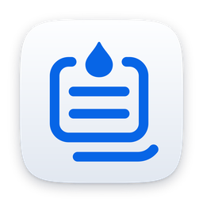

<div align="center">



# DewClip

**为 macOS 打造的本地优先剪贴板历史工具。**

[](https://github.com/REXKEV214/dew-clip/releases/latest)
[](https://github.com/REXKEV214/dew-clip/releases/latest)
[](LICENSE)

[English](README.md) · 简体中文

</div>

## 核心功能

### 剪贴板历史与实时搜索
- **多类型自动记录**：自动记录纯文本、富文本、代码、网址、图片，以及复制的文件与视频，保留来源应用图标与时间。内容重复时自动合并（纯文本相同但 HTML 格式不同的富文本会分别保留）。
- **输入即搜与分类筛选**：支持输入实时搜索，范围覆盖文字内容、文件与视频文件名、来源应用名以及图片中识别出的文字；支持按「文本、图片、视频、文件、网址、代码」快速筛选。
- **侧栏快速预览**：悬停或选中记录卡片后长按 <kbd>Space</kbd>，即可在侧栏预览完整文本、原图或视频。

### 快捷粘贴、批量操作与顺序粘贴
- **键盘直达粘贴**：按 <kbd>↩</kbd> 粘贴选中项，按 <kbd>⇧</kbd> <kbd>↩</kbd> 以纯文本粘贴，按 <kbd>⌘</kbd> <kbd>1</kbd>–<kbd>⌘</kbd> <kbd>9</kbd> 直接粘贴前 9 条记录（长按 <kbd>⌘</kbd> 显示数字角标），或按 <kbd>⌘</kbd> <kbd>C</kbd> 仅复制到剪贴板。
- **粘贴格式与编辑**：右键文本类记录可按原格式、纯文本或 Markdown 粘贴（富文本转为 Markdown，代码自动加代码块围栏）；支持直接编辑文字并「保存并粘贴」「保存」或「另存」为新记录。
- **批量操作**：多选记录可批量删除，也可拖动排序并选择连接符（换行、空格或标点）一次性批量粘贴，粘贴后自动恢复先前的系统剪贴板。
- **顺序粘贴**：从顶栏或菜单栏开启顺序粘贴会话，之后复制的内容会自动按顺序入队；也可从批量模式发起单轮顺序粘贴。在侧栏调整顺序或删减条目后，按 <kbd>⌥</kbd> <kbd>V</kbd> 依次粘贴（快捷键可自定义，仅在队列有内容时生效）。

### 常用内容
- **常用语与媒体收藏**：可手动添加常用语，或从历史记录右键收藏文本、图片、视频和文件。收藏的媒体会独立复制到数据目录，原文件移动或清空历史后仍可粘贴。
- **标题、标签与搜索**：支持为常用内容添加可选标题和标签、拖动排序、按标签筛选，以及按标题、标签、正文或文件名实时搜索。

### 本机图片识别与中英翻译
- **本机图片 OCR**：使用 Apple Vision 在本机识别图片中的简体中文、繁体中文与英文，既可用于搜索，也可点卡片上的「粘贴为文字」一键提取粘贴。
- **中英互译**：支持文本与富文本的中文与英文互译。macOS 26 及以上默认使用本机 Apple 翻译，也可切换为 DeepL 或任意 OpenAI 兼容服务（包括 Ollama 等本机回环服务）。

### 窗口、外观与菜单栏
- **深色模式与外观定制**：支持**跟随系统**、**浅色**、**深色**三种外观，提供 6 种主题色与可调玻璃透明度，同时作用于主面板与复制提示弹窗。
- **灵活窗口行为**：可在其他应用的原生全屏空间上直接唤出，支持跟随鼠标 / 上次打开 / 固定位置弹出，并提供**始终置顶**与**普通固定**两种固定窗口模式。
- **复制提示与菜单栏控制**：可选顶部复制提示弹窗（玻璃胶囊、黑色刘海、黑色胶囊，可调停留时间），支持隐藏菜单栏或 Dock 图标、中英文界面实时切换（菜单栏菜单同步更新），以及直接从菜单栏按时长暂停记录。

## 安装与首次打开

前往 [GitHub Releases](https://github.com/REXKEV214/dew-clip/releases/latest) 下载 `DewClip_1.2.0.dmg`（适用于 Apple 芯片 Mac）。

1. 打开 `.dmg`，将 `DewClip.app` 拖入「应用程序」文件夹。
2. 从「应用程序」文件夹启动 DewClip。
3. 若 macOS 弹出无法验证开发者的拦截提示，关闭该弹窗。
4. 打开「系统设置 → 隐私与安全性」，在「安全性」区域找到 DewClip，点击「仍要打开」。
5. 在二次确认窗口再次选择「仍要打开」，使用触控 ID 或密码验证后即可启动。

> [!NOTE]
> DewClip 发布包使用固定自签名证书（`"DewClip Release Signing"`）签名，而非 Apple Developer ID，且未经过 Apple 公证。通过浏览器下载 `.dmg` 安装后，首次启动仍需要上述一次性「仍要打开」放行步骤。

## 快捷键与常用操作

| 操作 | 快捷键 / 方式 | 说明 |
| --- | --- | --- |
| 呼出 / 隐藏面板 | <kbd>⌥</kbd> <kbd>Z</kbd> | 新安装默认值，可在设置中自定义 |
| 上下选择记录 | <kbd>↑</kbd> / <kbd>↓</kbd> | 在历史列表中移动选中项 |
| 粘贴选中项 | <kbd>↩</kbd> 或单击卡片 | 未授辅助功能权限时仅写入剪贴板 |
| 以纯文本粘贴 | <kbd>⇧</kbd> <kbd>↩</kbd> | 去除格式粘贴当前选中项 |
| 快捷粘贴前 9 条 | <kbd>⌘</kbd> <kbd>1</kbd>–<kbd>⌘</kbd> <kbd>9</kbd> | 长按 <kbd>⌘</kbd> 显示数字角标 |
| 仅复制不粘贴 | <kbd>⌘</kbd> <kbd>C</kbd> | 将选中项放回系统剪贴板 |
| 快速预览 | 长按 <kbd>Space</kbd> | 预览悬停或选中的卡片，松开关闭 |
| 聚焦搜索栏 | <kbd>⌘</kbd> <kbd>F</kbd> | 搜索历史记录；焦点在常用面板时搜索常用内容 |
| 切换分类标签 | <kbd>Tab</kbd> / <kbd>⇧</kbd> <kbd>Tab</kbd> | 在「全部」与各内容分类间循环切换 |
| 批量全选 | <kbd>⌘</kbd> <kbd>A</kbd> | 进入批量模式并全选当前已加载记录 |
| 顺序粘贴下一项 | <kbd>⌥</kbd> <kbd>V</kbd> | 默认快捷键；仅在队列有内容时生效 |
| 删除记录 | <kbd>⌘</kbd> <kbd>⌫</kbd> 或 <kbd>Delete</kbd> | 删除选中项，或在批量模式下确认删除 |
| 关闭窗口 | <kbd>⌘</kbd> <kbd>W</kbd> | 隐藏并取消固定窗口；有未保存修改时会提示 |
| 退出 / 取消固定 | <kbd>Esc</kbd> | 依次关闭编辑器、侧栏或搜索，再隐藏并取消固定窗口 |
| 更多操作 | 右键记录卡片 | 用默认应用打开、选择粘贴格式、添加到常用、批量操作、加入顺序粘贴队列（顺序粘贴进行中时显示）、不再记录此应用、系统分享 |

## 系统要求与权限

| 要求 | 说明 |
| --- | --- |
| **最低系统版本** | macOS 14 或更新版本（Apple 芯片）；仅在 macOS 26 上测试。 |
| **macOS 26 或更新版本** | 原生 Liquid Glass 液态玻璃效果与本机 Apple 翻译需要 macOS 26。 |

### 权限与系统弹窗说明
- **辅助功能（推荐授予）**：仅用于模拟 <kbd>⌘</kbd> <kbd>V</kbd> 完成自动粘贴、批量粘贴与顺序粘贴。不授予时，DewClip 仍可正常记录与搜索，点击记录后会将其写入剪贴板供你手动按 <kbd>⌘</kbd> <kbd>V</kbd> 粘贴。
- **开机自启动**：全新安装并从「应用程序」首次启动时，DewClip 会默认开启一次「开机自启动」（macOS 可能提示“已添加后台项目”）。你可随时在「设置 → 常用设置」中关闭。
- **文件夹访问提示**：仅当你复制或打开「桌面」「下载」等受保护目录中的文件时，macOS 会按需询问一次。
- **钥匙串访问提示**：仅在保存第三方翻译 API Key 时由系统弹出。

## 数据、存储与隐私

- **纯本地存储**：历史记录与常用内容默认保存在 `~/Library/Application Support/io.github.rexkev214.dewclip`，缩略图缓存在 `~/Library/Caches/io.github.rexkev214.dewclip`，下载的更新安装包保存在 `~/Library/Caches/io.github.rexkev214.dewclip/updates/`。在「设置 → 数据管理」中，可将数据迁移到其他空文件夹、关闭「持久化存储」（新记录仅保留在当前会话内存中）、设置「历史保留时间」（7 天至 1 年，或永久）与可选的「存储空间上限」（500 MB 至 5 GB），查看各项空间占用并清除缩略图缓存。自动清理会保留置顶记录、带标签记录与常用内容。
- **隐私保护**：带有密码管理器隐藏或临时标记的剪贴板内容（`org.nspasteboard.ConcealedType`、`TransientType`、`AutoGeneratedType` 等）绝不会被记录。你也可以在「忽略的应用」中添加不希望记录的程序（或在记录卡片上右键选择「不再记录此应用」），或从菜单栏临时暂停记录。
- **本地密钥保护**：第三方翻译 API Key 经加密存入本地数据库，主密钥由 macOS 钥匙串保管。

### 网络使用说明

DewClip 无需账号，无遥测统计，无云同步。应用仅在以下三种情况联网，除此之外不会发起任何网络请求：

| 功能 | 发送内容 | 控制方式与说明 |
| --- | --- | --- |
| **第三方翻译**（DeepL / OpenAI 兼容） | 打开翻译面板时立即发送该条记录正文（以及再次点击翻译时的正文）；点击「测试连接」时发送固定英文测试句 | 仅在你主动配置并使用第三方服务时触发。Apple 翻译完全在本机运行（语言包由 macOS 管理），本机回环地址（如 Ollama）仅请求本机。 |
| **复制网页富文本中的网络图片** | 向富文本中引用的 `https://` 图片地址发起下载请求 | 默认开启以便保留网页富文本中的图片；仅允许 HTTPS，屏蔽本地与内网地址。可在「设置 → 隐私」中关闭或限制单张体积（2–16 MB）。 |
| **检查与下载更新** | 每天最多向 GitHub Releases API（`api.github.com/repos/REXKEV214/dew-clip/releases/latest`）发送一次请求；发现新版本时，从 `github.com` 发布下载链接（重定向至 `release-assets.githubusercontent.com`）下载 `.dmg` 安装包。所有请求仅携带 `User-Agent: DewClip`，不含设备信息或 Cookie | 默认开启，可在「设置 → 常用设置」中关闭（关闭时会同时清除已缓存的安装包），也可在设置页底部手动点击「检查更新」。后台自动下载会跳过按流量计费的网络和低数据模式，若卡顿达 15 秒或速度低于约 100 KB/s 会中止并在 1 小时后重试，下载完成后对照 GitHub 发布的校验和验证文件大小与 SHA-256。未经你确认绝不安装。 |

## 更新、卸载与常见问题

<details>
<summary><strong>如何更新 DewClip？</strong></summary>

**从 1.0.x 或 1.1.x 升级到 1.2.0**

DewClip 1.1.0 仅支持提示新版本并跳转发布页（1.0.0 不含更新检查），尚无应用内下载功能，因此本次升级到 1.2.0 需要手动安装：下载 `DewClip_1.2.0.dmg`，退出正在运行的 DewClip，再将新 `DewClip.app` 拖入「应用程序」替换旧版。历史记录、常用内容与设置都会保留。

**从 1.2.0 起（应用内更新）**

- 默认每天检查一次 GitHub Releases；发现新版本时，DewClip 会在后台将发布 `.dmg` 下载到 `~/Library/Caches/io.github.rexkev214.dewclip/updates/`，仅接受 GitHub 官方发布下载域名，并对照 GitHub 发布的校验和验证文件大小与 SHA-256。
- 后台自动下载会自动跳过按流量计费的网络（如个人热点）和低数据模式；若下载停滞达 15 秒或速度低于约 100 KB/s 会放弃并在 1 小时后重试。在设置页底部手动点击「检查更新」会立即开始下载，包括在按流量计费的网络或低数据模式下。
- 安装包校验就绪后，面板横幅、设置按钮圆点与菜单栏都会提示可安装更新。未经你确认绝不会自动安装，更新过程也不会改动剪贴板历史、常用内容或设置。
- 点击「安装并重新打开」后，DewClip 会退出、替换应用并重新打开新版本；替换期间会保留旧版应用作为备份，直到新版本成功打开，如遇失败则自动恢复旧版。
- 当无法自动替换时（例如「应用程序」目录不可写、应用并非从该目录运行，或新版本签名不一致），DewClip 会退出并在访达中显示已校验的安装包，供你手动将 `DewClip.app` 拖入「应用程序」。
- 点击「稍后」会暂时隐藏横幅直到下次启动；只要旧版再次打开且更新仍在等待安装，提醒就会重新出现。
- 缓存中始终只保留一个安装包。在「设置 → 常用设置」关闭更新检查、跳过该版本或重置设置时，安装包缓存会自动清空。若某个发布没有适用的安装包，则会回退为跳转到发布页手动更新。

</details>

<details>
<summary><strong>更新后无法自动粘贴，只复制到剪贴板怎么办？</strong></summary>

从 1.2.0 起，DewClip 正式发布包改用固定自签名证书（`"DewClip Release Signing"`）签名。由于签名方式从 ad-hoc 变为固定证书，**从 1.0.x 或 1.1.x 升级到 1.2.0 时，辅助功能授权仍会最后重置一次**。

从 1.2.0 之后，使用同一证书签名的后续更新将保留辅助功能授权（已在 macOS 26 上实测：用同一证书签名的构建覆盖替换后，无需重新授权即可继续自动粘贴）。

如果你刚从 1.0.x 或 1.1.x 升级（或使用了从源码构建的 ad-hoc 版本）且自动粘贴失效，请按以下步骤恢复：
1. 在 DewClip 弹窗中点击「授权」，或在「设置 → 常用设置」点击「去授权」，在系统设置中重新开启。
2. 若仍无法自动粘贴，打开「系统设置 → 隐私与安全性 → 辅助功能」，选中 **DewClip** 后点击 **−** 移除，再点击 **+** 重新添加 `/Applications/DewClip.app` 并打开开关。

如曾保存第三方翻译 API Key，从 1.0.x 或 1.1.x 升级后首次使用时，macOS 也可能再次请求一次钥匙串授权。

</details>

<details>
<summary><strong>为什么在 macOS 14 或 15 上看不到翻译按钮？</strong></summary>

默认翻译服务为 Apple 翻译，需要 macOS 26 或更新版本。当前翻译服务不可用时，卡片不会显示翻译按钮。

打开「设置 → 翻译」，切换为 **DeepL** 或 **OpenAI 兼容**服务（包括 Ollama 等本机服务）并完成配置后，文本和富文本卡片即会显示翻译按钮。

</details>

<details>
<summary><strong>如何彻底卸载 DewClip？</strong></summary>

1. 如开启了「开机自启动」，先在「设置 → 常用设置」中关闭。
2. 从菜单栏图标退出 DewClip（如隐藏了图标，可在活动监视器中退出）。
3. 将 `/Applications/DewClip.app` 移到废纸篓。
4. 删除本地数据、缓存、偏好设置及可能存在的自启动配置文件：
   ```bash
   rm -rf ~/Library/Application\ Support/io.github.rexkev214.dewclip
   rm -rf ~/Library/Caches/io.github.rexkev214.dewclip
   rm -rf ~/Library/WebKit/io.github.rexkev214.dewclip
   rm -f ~/Library/Preferences/io.github.rexkev214.dewclip.plist
   rm -f ~/Library/LaunchAgents/io.github.rexkev214.dewclip.autostart.plist
   ```
   *（如曾在设置中更改过数据存储路径，请一并删除自定义目录。）*
5. 打开「钥匙串访问」，删除 `io.github.rexkev214.dewclip.clipboard`（如存在）。
6. 打开「系统设置 → 隐私与安全性 → 辅助功能」，从列表中移除 DewClip。

</details>

## 从源码构建

### 环境要求
- **Node.js**
- **Rust**
- 包含 **macOS 26 SDK** 的 **Xcode**（用于编译 Swift 桥接代码）
- **Git**（首次拉取 Rust 依赖时需要）

### 常用命令

安装前端依赖：

```bash
npm ci
```

启动开发版（按 `Ctrl+C` 退出）：

```bash
npm run tauri:dev
```

运行测试与代码检查：

```bash
npm test
npm run test:rust
npm run lint
```

构建 ad-hoc 签名包（任何人都可构建）：

```bash
npm run tauri:build
```

构建维护者签名发布包（使用 `"DewClip Release Signing"` 证书签名，缺少该证书时会构建失败）：

```bash
npm run tauri:build:release
```

- 开发版数据目录与正式版隔离，位于 `~/Library/Application Support/io.github.rexkev214.dewclip.dev`。
- 构建生成的 `.app` 与 `.dmg` 位于 `src-tauri/target/release/bundle/`。

## 许可证

本项目基于 GNU General Public License v3.0（GPL-3.0）开源。
Copyright © 2026 REXKEV214，详见 [LICENSE](LICENSE) 与 [NOTICE](NOTICE)。
